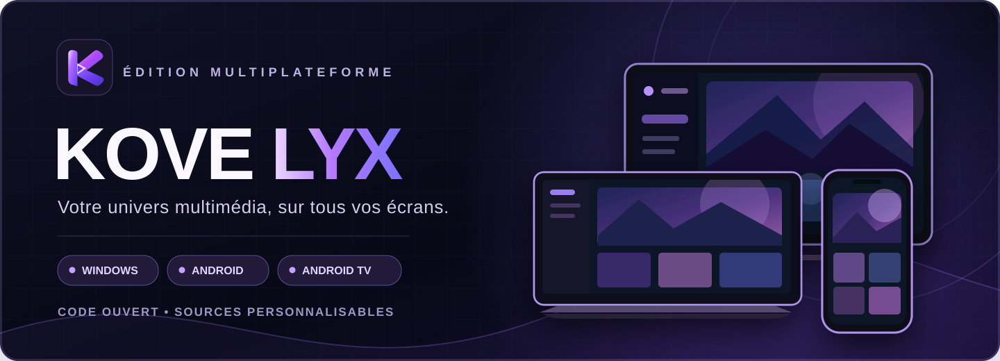
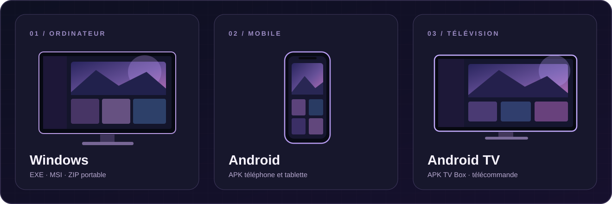
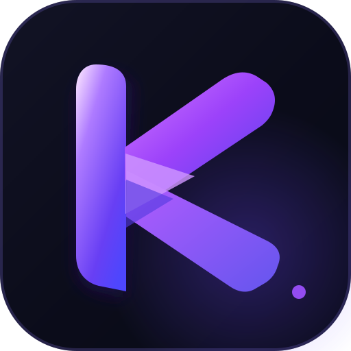

[**Télécharger la dernière version — Windows · Android · Android TV**](https://github.com/anderson76389/Kovelyx/releases/latest)

Les profils TV reçoivent les noms, photos et fonds du compte ; leur modification se fait sur Android mobile ou PC.

 

### Votre univers multimédia. Vos écrans. Vos choix.

**Kovelyx** réunit découverte, bibliothèque, lecture et personnalisation dans trois applications conçues pour **Windows, Android et Android TV**.

Projet open source • Versions actuellement en préversion • Sources et builds hébergés dans ce dépôt

---

## ✦ Trois expériences. Un seul univers.

<table align="center" width="100%">
  <thead>
    <tr>
      <th align="center" colspan="3">
        
        
Illustration conceptuelle, non issue d'une application installée.

      </th>
    </tr>
    <tr>
      <th align="center" width="33%">🖥️ Windows</th>
      <th align="center" width="34%">📱 Android mobile</th>
      <th align="center" width="33%">📺 Android TV</th>
    </tr>
  </thead>
  <tbody>
    <tr>
      <td align="center">Windows 10 et 11 · x64</td>
      <td align="center">Téléphones et tablettes · Android 7+</td>
      <td align="center">Télévisions et TV Box · Android 7+</td>
    </tr>
    <tr>
      <td align="center">EXE · MSI · ZIP portable</td>
      <td align="center">APK Android universel</td>
      <td align="center">APK TV universel · télécommande</td>
    </tr>
    <tr>
      <td align="center"><a href="https://anderson76389.github.io/Kovelyx/?plateforme=desktop#plateformes"><strong>Télécharger Windows</strong></a></td>
      <td align="center"><a href="https://anderson76389.github.io/Kovelyx/?plateforme=android#plateformes"><strong>Télécharger Android</strong></a></td>
      <td align="center"><a href="https://anderson76389.github.io/Kovelyx/?plateforme=tv#plateformes"><strong>Télécharger Android TV</strong></a></td>
    </tr>
  </tbody>
</table>

**[🌐 Accéder au site des applications](https://anderson76389.github.io/Kovelyx/) · [📦 Voir toutes les Releases](https://github.com/anderson76389/Kovelyx/releases)**

> **Important :** les fichiers proposés sont des **préversions expérimentales**, pas des versions stables certifiées. Pour les APK de test, la signature peut changer : une mise à jour par-dessus la précédente peut échouer. Sauvegardez vos données locales avant de remplacer ou désinstaller une application.

---

## ✨ Une expérience qui vous ressemble

<table>
<tr>
<td width="50%" valign="top"><h3>🎬 Explorer et retrouver</h3>
Parcourir des catalogues, chercher des films et séries et organiser sa bibliothèque autour de ses sources et extensions compatibles.
</td>
<td width="50%" valign="top"><h3>▶️ Lire à sa façon</h3>
Lecteur intégré, sélection de sources, gestion des pistes audio et sous-titres, reprise de lecture et réglages selon la plateforme.
</td>
</tr>
<tr>
<td valign="top"><h3>🎨 Une interface personnelle</h3>
Thèmes, profils, avatars et arrière-plans personnalisés. L'importation de photos, GIF et vidéos fait l'objet d'une nouvelle version en cours de validation.
</td>
<td valign="top"><h3>🧩 Des connexions modulaires</h3>
Extensions, catalogues, Trakt, MDBList et services tiers configurables selon les fonctionnalités disponibles et les identifiants requis.
</td>
</tr>
</table>

**Aucun catalogue de contenu protégé ni flux vidéo n'est fourni avec Kovelyx.** Les disponibilités dépendent des sources et fournisseurs configurés par l'utilisateur, ainsi que des droits applicables.

## ☁️ Votre compte Kovelyx — en cours de développement

Un backend distinct de Nuvio est en place autour de **Cloudflare Workers, D1 et Better Auth**. Des tests de création de compte, de connexion et d'isolation des profils ont réussi sur le serveur et sur une base de test. Les adaptations des applications progressent.

| Déjà réalisé / testé | Encore expérimental ou incomplet |
|:---|:---|
| Worker HTTPS et base D1 | Connexion fiable sur les trois appareils réels |
| Inscription/connexion et profils testés côté serveur | Session conservée après fermeture de l'application |
| Premiers clients de compte Windows, Android et TV | Synchronisation intégrale de la bibliothèque et de la progression |
| Premiers adaptateurs de bibliothèque Windows / Android | Synchronisation TV, préférences, addons et conflits complets |
| Imports locaux de médias de profil dans la branche de travail | Photos/GIF/vidéos synchronisés via R2 et validés sur trois appareils |

La synchronisation universelle **n'est pas encore annoncée comme fonctionnelle**. Les développements en cours sont dans la [PR nº 40](https://github.com/anderson76389/Kovelyx/pull/40), qui n'est pas fusionnée aux Releases publiques.

**[Documentation du serveur Cloudflare](./services/kovelyx-cloudflare/README.md) · [État précis de la synchronisation](https://github.com/anderson76389/Kovelyx/blob/feature/cloudflare-profile-sync-safe-20261019/docs/ETAT_SYNCHRO_CLOUDFLARE.md)**

---

## 🛠️ Code, tests et état technique

Le projet rassemble les sources de ses trois applications, l'infrastructure de compte et les outils de compilation dans **un seul dépôt**.

| Répertoire | Contenu |
|:---|:---|
| [apps/desktop](./apps/desktop/) | Application Windows / Compose |
| [apps/mobile](./apps/mobile/) | Application Android mobile |
| [apps/tv](./apps/tv/) | Application Android TV et TV Box |
| [services/kovelyx-cloudflare](./services/kovelyx-cloudflare/) | Worker de comptes, base D1 et synchronisation |
| [vendor/engine](./vendor/engine/) | Sources du moteur conservées dans le dépôt |
| [assets/brand](./assets/brand/) | Logo, bannière et visuels de présentation |
| [docs](./docs/) | Site, guides, audits et documentation |

**Contrôles automatiques**

Le code peut être compilé avec les anciens domaines Nuvio bloqués dans les scénarios testés. En revanche, **une compilation réussie ne prouve pas que chaque bouton, addon, lecteur ou connexion externe fonctionne en situation réelle**. La suite Android TV complète présente encore des échecs à corriger dans la branche de développement.

**[Audit d'indépendance](./docs/AUDIT_INDEPENDANCE_3_VERSIONS.md) · [État technique](./docs/ETAT_TECHNIQUE.md) · [Tests manuels PC](./docs/TESTS_PC.md) · [Suivi GitHub Actions](https://github.com/anderson76389/Kovelyx/actions)**

## 🧭 Feuille de route

- [x] Trois projets Windows / Android / TV regroupés dans le même dépôt.
- [x] Identité Kovelyx, site de téléchargement et premières Releases par plateforme.
- [x] Compilations et premiers tests de lancement avec anciens domaines Nuvio bloqués.
- [x] Premier backend de comptes Cloudflare, avec tests d'authentification et de base D1.
- [ ] Finaliser et tester les connexions persistantes sur les trois appareils.
- [ ] Achever la synchronisation des profils, bibliothèques, historiques et préférences, y compris la TV.
- [ ] Valider partout les photos, GIF animés et vidéos des profils ; activer R2 uniquement si souhaité.
- [ ] Corriger les tests Android TV restants et vérifier le lecteur, les sources, l'audio et les sous-titres sur appareils physiques.
- [ ] Garantir signature Android durable, migration sans perte de données et mises à jour installables.
- [ ] Finaliser les audits de reproductibilité des composants natifs et d'indépendance réseau.

## 🔐 Indépendance, confidentialité et licences

**L'objectif est de ne dépendre d'aucun service Nuvio pour exploiter Kovelyx.** Les sources, distributions et premières infrastructures sont hébergées sous Kovelyx. L'indépendance intégrale du fonctionnement reste à certifier : des modules historiques, protocoles compatibles et composants natifs subsistent encore. Les API tierces telles que TMDB, Trakt, MDBList, les extensions ou les fournisseurs de lecture restent des dépendances distinctes.

Kovelyx dérive de logiciels sous **GNU GPLv3**. Les notices, crédits d'auteurs et obligations de licences sont conservés conformément aux licences applicables ; les supprimer ne renforcerait pas l'indépendance technique.

[**Provenance et licences**](./docs/PROVENANCE.md) · [**Confidentialité**](https://anderson76389.github.io/Kovelyx/confidentialite.html) · [**Conditions d'utilisation**](https://anderson76389.github.io/Kovelyx/conditions.html) · [**Audit Nuvio**](./docs/AUDIT_NUVIO.md)

---

### KOVELYX

**Windows · Android · Android TV**

*Votre univers multimédia, sur tous vos écrans.*

[Site officiel](https://anderson76389.github.io/Kovelyx/) · [Téléchargements](https://github.com/anderson76389/Kovelyx/releases) · [Problèmes et suggestions](https://github.com/anderson76389/Kovelyx/issues) · [Retour en haut ↑](#)

